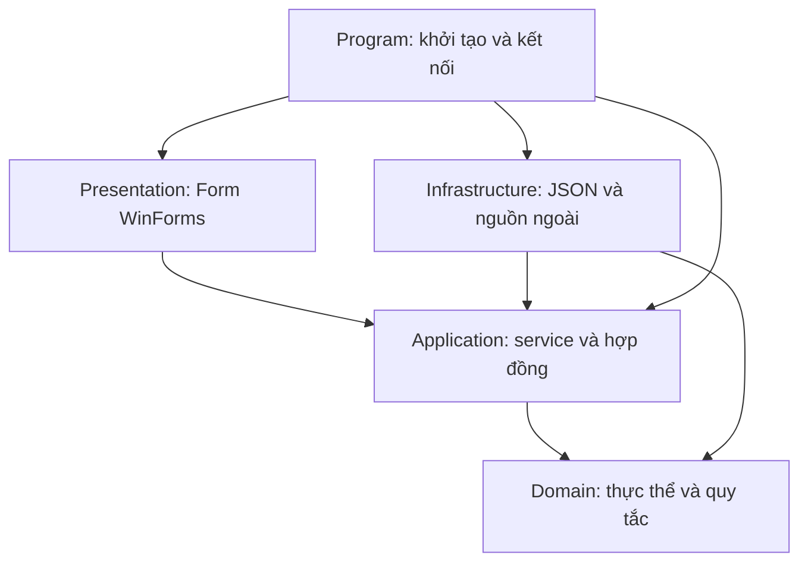

# Kiến trúc và mẫu thiết kế hệ thống quản lý thư viện

Tài liệu xác định cách tổ chức và phối hợp các thành phần của LibraryManagementSystem, phân quyền, lưu trữ JSON và ba mẫu thiết kế Factory Method, Strategy, Observer.

- [Phân tích yêu cầu](../Analysis/01-phan-tich-yeu-cau.md).
- [Đặc tả Use Case](../Analysis/02-use-case.md).
- [Thiết kế lớp](03-thiet-ke-lop.md): thuộc tính, quan hệ và bảng ánh xạ UC/BR với phương thức.

## 1. Phạm vi và nền tảng

Ứng dụng desktop C# trên .NET 10, giao diện Windows Forms, phát triển bằng VS Code; dữ liệu lưu bằng JSON trên một máy tính. Độc giả, thủ thư và người quản lý đăng nhập theo vai trò. Nguồn nhà trường sử dụng dữ liệu giả lập; thông báo được hiển thị trong ứng dụng.

Các lớp nghiệp vụ dùng chung cho hai phân hệ, không nhân đôi hồ sơ độc giả hoặc cuốn sách.

## 2. Kiến trúc và phạm vi trách nhiệm

| Thành phần | Trách nhiệm | Giới hạn |
| --- | --- | --- |
| `Domain/Entities` | 26 lớp thực thể, gồm lớp trừu tượng DocGia và hai lớp kế thừa | Giữ dữ liệu, bất biến và chuyển trạng thái; không nhập/xuất giao diện. |
| `Domain/ValueObjects` | ViTriKe biểu diễn vị trí theo giá trị | Không có định danh thực thể riêng; không tính vào 26 lớp. |
| `Domain/Services`, `Interfaces`, `Strategies` | Lịch mở cửa, quy tắc mượn và chính sách phạt/định giá | Thực hiện cùng một chính sách cho cả hai phân hệ; không phụ thuộc WinForms. |
| `Domain/Factories` | Tạo đúng loại độc giả | Không tạo trùng hồ sơ hoặc bỏ qua xác minh. |
| `Application/Services` | 11 service điều phối Use Case, kiểm tra quyền và dữ liệu liên đối tượng | Không chứa thao tác điều khiển giao diện; không nhân đôi mô hình thực thể. |
| `Application/Interfaces` | Hợp đồng lưu trữ, giao dịch, kho sách, trường, nhật ký, thông báo | Tách nghiệp vụ khỏi cách lưu JSON và cách kết nối cụ thể. |
| `Application/Events`, `Observers` | Phát sự kiện để ghi nhật ký, tạo/gửi thông báo | Quyền nhận và dữ liệu nghiệp vụ được chốt trước; observer xử lý thông báo và nhật ký từ sự kiện đã lưu. |
| `Infrastructure` | Cấu hình, nguồn trường giả lập, nhật ký, thông báo và hiện thực lưu trữ JSON | Thực thi hợp đồng; không tự quyết định hạn mức hoặc tỷ lệ bồi thường. |
| `Presentation` | Các Form WinForms nhận dữ liệu, hiển thị kết quả, gọi service | Không trực tiếp tính phạt, quyết định quyền hay sửa trạng thái thực thể. |
| `Program` | Khởi tạo, kết nối thành phần và điểm chạy chương trình/kiểm thử | Không dồn toàn bộ nghiệp vụ vào Main. |

### 2.1. Hai phân hệ

| Phân hệ | Use Case | Phụ trách chính |
| --- | --- | --- |
| PH-A — Độc giả, danh mục và hàng chờ | UC01, UC02, UC06, UC07, UC10, UC11 | Trần Thị Hà Lan |
| PH-B — Lưu thông, sự cố và thống kê | UC03, UC04, UC05, UC08, UC09, UC12 | Hoàng Văn Quân |

Các lớp thực thể được định nghĩa một lần và dùng chung qua các service.

### 2.2. Chiều phụ thuộc

Mũi tên biểu diễn phụ thuộc mã nguồn. Application sử dụng các interface đã định nghĩa; đối tượng hiện thực được Program truyền vào lúc khởi tạo. Vì vậy Application gọi được nơi lưu JSON mà không phụ thuộc tên lớp lưu JSON cụ thể.

- Domain không gọi WinForms, MessageBox, Console hoặc đọc/ghi file JSON.
- `QuyTacMuon` nhận thực thể và dữ liệu đã được service truy vấn, không phụ thuộc IRepository của tầng Application. `LichMoCua` nhận cấu hình đã được nạp, không tự gọi ConfigurationLoader.
- Application điều phối giao dịch, kiểm tra quyền và dữ liệu nhiều đối tượng; quy tắc của một đối tượng được thực thi trong phương thức của đối tượng đó.
- Infrastructure hiện thực lưu trữ, kênh thông báo, nguồn trường và nhật ký; không tự quyết định hạn mức hoặc mức bồi thường.
- Presentation chỉ nhận/hiển thị dữ liệu và gọi service; không tự thay trạng thái, cộng hạn hoặc tính phạt.
- Program tạo một bộ thành phần dùng chung cho phiên chạy. Có thể truyền phụ thuộc qua constructor trực tiếp; không cần thêm framework DI cho bài tập.

## 3. Phối hợp xử lý nghiệp vụ

### 3.1. Quy trình chung của một lệnh

1. Form nhận dữ liệu, kiểm tra định dạng và chuyển lệnh cùng mã yêu cầu vào service.
2. Service lấy tài khoản từ phiên đã xác thực; kiểm tra quyền chức năng và quyền trên đối tượng.
3. Kiểm tra mã yêu cầu đã xử lý, đọc dữ liệu hiện tại và kiểm tra lại điều kiện nghiệp vụ.
4. Gọi phương thức thực thể và chính sách cần thiết; thay đổi dữ liệu trong phạm vi giao dịch nhất quán.
5. Lưu đối tượng, liên kết, kết quả yêu cầu và sự kiện/nhật ký bắt buộc. Chỉ thông báo thành công khi lưu được xác nhận.
6. Phát các sự kiện đã lưu cho observer; lỗi gửi thông báo không làm mất giao dịch thành công.
7. Form hiển thị kết quả hoặc lý do bị từ chối; không hiển thị lỗi như danh sách rỗng thành công.

Service không tin mã vai trò do người dùng nhập. Độc giả tự thao tác phải là chủ hồ sơ/dòng mượn/đăng ký. Hạn mức, quyền nhận và công nợ được kiểm tra lại trong cùng phạm vi bảo vệ giao dịch, không chỉ tại lúc mở màn hình.

### 3.2. Mượn nhiều cuốn — UC03

`MuonTraService` lấy độc giả, thẻ, công nợ, nghĩa vụ trên mọi phiếu và trạng thái từng cuốn. `QuyTacMuon.KiemTraMuon` kiểm tra toàn bộ yêu cầu. `DocGia.GioiHanCuon()` xác định 3/5 cuốn; `DocGia.SoNgayMuon()` và `ILichMoCua.CongNgayMoCua()` xác định hạn 14/30 ngày mở cửa.

Nếu một cuốn không hợp lệ, từ chối cả danh sách; chưa lập phiếu cho phần còn lại. Khi hợp lệ, tạo PhieuMuon/ChiTietMuon, gọi CuonSach.DanhDauMuon và cập nhật lượt giữ chỗ liên quan trong một giao dịch. Thủ thư giao sách sau khi lưu thành công. Nếu người thứ nhất nhận từ giữ chỗ, HangChoService kiểm tra lại người thứ hai theo dòng mượn mới; không cấp quyền nhận cuốn đang cho mượn.

### 3.3. Trả sách và thu tiền — UC05

`MuonTraService.TraTungCuon` ghi ngày nhận thật, tình trạng và ngày chốt phạt. `LichMoCua` đếm ngày mở cửa quá hạn, `IChinhSachPhat` tính số tiền; sự cố hỏng do SuCoService xử lý. `ThanhToanService` ghi tiền thực nhận và phân bổ vào các khoản riêng.

Theo Q01, nếu đã nhận sách mà chưa thu được tiền, vẫn giữ ngày nhận thật và công nợ; không tăng phạt sau ngày nhận. Lần nộp tiền sau không tạo thêm lần trả. Cuốn dùng được phải qua HangChoService xét ưu tiên trước khi giao tiếp; khoản nợ của người cũ không làm cuốn vẫn thuộc quyền giữ của họ.

### 3.4. Hàng chờ — UC06 và UC07

HangChoService tạo/hủy đăng ký, bảo đảm mỗi độc giả chỉ một đăng ký hiệu lực toàn thư viện. Khi cuốn có thể giao, chọn tối đa hai người theo thứ tự; mốc thẻ 21/37 ngày lấy từ loại người mượn của dòng nguồn. Chỉ một lượt được kích hoạt, kết thúc lúc 17:00 ngày mở cửa thứ hai sau ngày cấp quyền.

Người thứ hai được kiểm tra lại và có thời hạn riêng khi chuyển quyền. Sau hai lượt không giao được, kết thúc đợt và không lập ngay đợt mới để kéo người thứ ba vào cùng lần sẵn sàng. Tạm dừng do hỏng thì ngừng quyền nhận và thông báo toàn hàng; chuyển bản thay thế chỉ cho đăng ký hiệu lực đã đồng ý tiếp tục.

### 3.5. Mất/hỏng, bồi thường và bản thay thế — UC08, UC09

SuCoService lập sự cố, dùng chính sách định giá và phê duyệt cần thiết để chốt giá/tỷ lệ. Phạt quá hạn và bồi thường có KhoanThu riêng. ThanhToanService xác nhận tiền; bản thay thế đi qua phê duyệt và BienNhanThayThe, không được ghi như tiền thực thu.

Q02 chỉ tất toán mất khi đủ bồi thường và phạt đến ngày tất toán; phần phạt đã thu được khấu trừ. Tìm lại trước tất toán đi qua UC05 và đối soát chứng từ theo mục 8.1 tài liệu yêu cầu; tìm lại sau tất toán giữ lịch sử cuốn cũ thuộc người đọc. Không thu cả đủ tiền sách lẫn bản thay thế cho cùng nghĩa vụ.

### 3.6. Đóng hồ sơ — UC10

HoSoService đối soát sách, sự cố và khoản thu của cả hai phân hệ. Chỉ xác nhận/đóng khi đủ điều kiện; dùng TaiKhoanService vô hiệu hóa tài khoản và kết thúc quyền sử dụng. Người bị buộc rời trường được dừng quyền mới ngay nhưng giữ hạn trả và nghĩa vụ. Q04 không triển khai xóa/ẩn danh hồ sơ trong phiên bản bài tập.

## 4. Hợp đồng giữa các thành phần

| Thành phần trong khung | Hợp đồng/trách nhiệm |
| --- | --- |
| `ILichMoCua`, `LichMoCua` | LaNgayMoCua, NgayMoTiep, CongNgayMoCua, DemNgayMoCua, HanNhanSauHaiNgay; nhận ngày nghỉ và giờ đóng cửa cấu hình. |
| `QuyTacMuon` | KiemTraMuon, KiemTraGiaHan, KiemTraUngVien; tổng hợp thẻ, quyền, nợ, hạn mức, cuốn và hàng chờ. |
| `IChinhSachPhat`, `PhatTheoNgay` | TinhPhat(soNgay: int): decimal; 5.000 đồng/ngày mở cửa, không trần. |
| `IChinhSachDinhGia`, `DinhGiaTheoGiaBia`, `DinhGiaThuVien` | GiaTriSach(cuon: CuonSach): decimal; ưu tiên giá bìa, thiếu thì dùng định giá có duyệt; thiếu cả hai thì không tự đặt giá. |
| `DocGiaCreator`, `SinhVienCreator`, `GiangVienCreator` | Factory Method tạo đúng lớp SinhVien/GiangVien từ thông tin hợp lệ; lớp creator cơ sở định nghĩa phương thức tạo trừu tượng. |
| `IRepository<T>` | LayTheoMa, LayTatCa, Luu, CapNhat; hỗ trợ truy vấn và lưu thực thể, không xóa lịch sử tùy tiện. |
| `ITransactionManager` | BatDau, Commit, Rollback; bao trùm thay đổi cần nhất quán. Lưu JSON phải có cơ chế ghi nguyên tử/khôi phục phù hợp, không coi một loạt ghi file rời là giao dịch thành công. |
| `IQuanLyKhoSach`, `KhoSachService` | TimCuon, DanhDauMuon, DanhDauTra; phối hợp trạng thái cuốn. |
| `IDonViTruongGateway`, `DonViTruongGiaLap` | DuDoiTuong, TinhTrang; dữ liệu giả lập ghi rõ là dữ liệu bài tập. |
| `IKenhThongBao`, `ThongBaoTrongHeThong` | Gui(thongBao); lưu/gửi thông báo trong ứng dụng, chưa gửi email/SMS thật. |
| `INhatKyService`, `NhatKyService` | Ghi(nhatKy); lưu người/thời điểm/đối tượng/căn cứ, không lưu mật khẩu. |
| `IThuVienObserver`, `ThuVienEventPublisher`, `SuKienThuVien`, hai Observer | Observer: đăng ký, hủy đăng ký, phát sự kiện; NhatKyObserver ghi dấu vết và ThongBaoObserver xử lý thông báo. |
| `CauHinhThuVien`, `ConfigurationLoader` | Nạp cấu hình lịch, giờ đóng cửa, mức phạt và đường dẫn tương đối; kiểm tra cấu hình hợp lệ trước xử lý. |

`ITransactionManager` được dùng bởi service điều phối ngoài cùng. Các thao tác phụ thuộc cùng nhận phạm vi giao dịch đang mở; không tự commit riêng giữa một Use Case. `IRepository<T>.Luu/CapNhat` thay đổi bản dữ liệu của giao dịch, chỉ Commit mới công bố kết quả bền vững.

`ILichMoCua.CongNgayMoCua(ngayBatDau: DateOnly, soNgay: int): DateOnly` bỏ ngày bắt đầu, Chủ nhật và ngày nghỉ. `DemNgayMoCua(tuNgay: DateOnly, denNgay: DateOnly): int` đếm các ngày mở cửa sau tuNgay đến hết denNgay, trả 0 nếu denNgay không sau tuNgay. `HanNhanSauHaiNgay(lucCap: DateTimeOffset): DateTimeOffset` quy về ngày Việt Nam rồi chốt giờ đóng cửa của ngày mở cửa thứ hai sau đó.

Không dùng riêng trạng thái thẻ để thay thế kiểm tra ngày thực tế: thẻ có trạng thái hiện hành vẫn có thể đã hết hạn. Việc thay đổi lịch không tự sửa hạn đã giao; phép tính phạt dùng ngày mở cửa thực tế đã được xác nhận theo Q03.

### Hợp đồng Lan–Quân đề xuất

Tại commit `ffa17e9`, mã đã có 13 enum trạng thái với 55 giá trị theo UML, `NghiepVuException`, `ILichMoCua`, `IRepository<T>`, `ITransactionManager` và `IDonViTruongGateway`. Các tệp thực thể, hai interface Strategy, interface kho sách và nhóm Observer vẫn là khung trống.

**Chờ Lan và Quân xác nhận trước khi viết service.** Các chữ ký và mã lỗi dưới đây là đề xuất để hai bên rà soát cùng nhau.

| Điểm cần chốt | Đề xuất cho bên gọi và bên cài đặt |
| --- | --- |
| Factory tạo độc giả | Quân cung cấp `SinhVien(string maDocGia, string maTruong, string hoTen)` và `GiangVien(string maDocGia, string maTruong, string hoTen)`. Factory của Lan chọn lớp theo loại độc giả đã xác minh và trả về `DocGia`. |
| Tìm cuốn | `CuonSach? TimCuon(string maCuon)` trả về `null` nếu mã chưa tồn tại, cùng quy ước với `IRepository<T>.LayTheoMa`. Với thao tác bắt buộc có cuốn, service gọi chuyển kết quả này thành lỗi `KHONG_TIM_THAY`. |
| Chuyển trạng thái kho | Đề xuất `void DanhDauMuon(string maCuon, string maDocGia, long phienBanDuKien)` và `void DanhDauTra(string maCuon, TinhTrangSach tinhTrangNhan, long phienBanDuKien)`. Kho kiểm tra trạng thái và phiên bản hiện tại rồi cập nhật cuốn trong giao dịch do service gọi mở. |
| Báo lỗi giữa hai phần | Dùng `NghiepVuException.MaLoi` để bên gọi phân biệt lỗi. Giữ mã hiện có `KHONG_TIM_THAY`. Đề xuất `XUNG_DOT_PHIEN_BAN` khi dữ liệu đã đổi và `CUON_KHONG_THE_GIAO` khi cuốn đang mượn hoặc giữ cho người khác. Giao diện hiển thị thông báo kèm mã cuốn. |
| Strategy phạt và định giá | Quân khai báo `decimal TinhPhat(int soNgay)` và `decimal GiaTriSach(CuonSach cuon)`. Lan cung cấp giá bìa, giá định lại và mã phê duyệt trên cuốn. Nếu thiếu cả hai căn cứ giá, giữ sự cố chờ phê duyệt. |
| Thông báo và nhật ký | Lan khai báo `IKenhThongBao.Gui(ThongBao)`, `INhatKyService.Ghi(NhatKyThaoTac)` và hợp đồng Observer. Quân phát sự kiện với mã sự kiện, loại thao tác, thời điểm và mã đối tượng để Lan truy vết và tránh xử lý lặp. |
| Commit và phát sự kiện | `MuonTraService` mở và kết thúc giao dịch bao gồm phiếu, dòng mượn, trạng thái cuốn và lượt giữ chỗ liên quan. Nếu một cuốn trong yêu cầu mượn bị từ chối, rollback toàn bộ yêu cầu. Publisher phát sự kiện thành công sau commit. Observer dùng mã sự kiện để thử lại khi gửi thông báo lỗi. |

Hai bên kiểm tra hợp đồng bằng ba ca ở mục 4.2 của [thiết kế lớp](03-thiet-ke-lop.md). Bổ sung ca cạnh tranh UC03-E05: khi hai yêu cầu chọn cùng cuốn và cùng phiên bản, chỉ một yêu cầu được lưu phiếu. Yêu cầu còn lại phải đọc lại trạng thái trước khi thử lại.

## 5. Giao diện và phân quyền

| Nhóm màn hình WinForms | Service được gọi | Người được thao tác |
| --- | --- | --- |
| Đăng nhập | TaiKhoanService | Người có tài khoản hợp lệ. |
| Thẻ và hồ sơ | TheService, HoSoService | Thủ thư xử lý thẻ; quản lý xác nhận/đóng/dừng quyền theo thẩm quyền. |
| Danh mục | SachService | Thủ thư cập nhật; quản lý phê duyệt giá/thanh lý. |
| Mượn, trả và gia hạn | MuonTraService, GiaHanService | Thủ thư giao/nhận; độc giả chỉ tự gia hạn dòng của mình. |
| Hàng chờ | HangChoService | Độc giả quản lý đăng ký của mình; thủ thư xử lý trong quyền. |
| Sự cố, thay thế và thanh toán | SuCoService, SachService, ThanhToanService | Thủ thư ghi nhận/thu; quản lý phê duyệt phần được yêu cầu. |
| Tra cứu và thống kê | TraCuuThongKeService | Độc giả xem dữ liệu của mình/danh mục; nhân viên có quyền xem báo cáo tổng hợp. |

Mỗi service kiểm tra quyền khi thực thi, kể cả khi được gọi trực tiếp trong kiểm thử. Tài khoản quản lý không tự được bỏ qua quy tắc. Tác vụ nội bộ nhắc quá hạn/hết lượt phải có ngữ cảnh hệ thống hợp lệ; vẫn áp dụng cùng chính sách với thao tác thủ công. Giao diện không truy cập repository để cập nhật trực tiếp.

### 5.1. Phạm vi màn hình

| Nhóm giao diện | Dữ liệu hiển thị/nhập chính | Hành động cần kiểm soát |
| --- | --- | --- |
| Thẻ và hồ sơ | Mã trường, loại độc giả, hiệu lực thẻ, nghĩa vụ | Phân biệt cấp lại với khôi phục; đóng hồ sơ phải qua đối soát. |
| Danh mục | Đầu sách, từng cuốn, tác giả, thể loại, NXB, kệ và giá có căn cứ | Không cung cấp nút sửa trạng thái để biến sách đang mượn thành sẵn sàng. |
| Mượn/trả | Danh sách cuốn, tình trạng giao/nhận, hạn trả, khoản phát sinh | Hiển thị kết quả cho từng cuốn; phân biệt nhận trả với thanh toán. |
| Hàng chờ | Thứ tự, đợt, người có quyền hiện tại và hạn nhận | Đăng ký chưa phải quyền nhận; độc giả không tự chọn vị trí trong hàng. |
| Sự cố và thanh toán | Minh chứng, giá/tỷ lệ, phê duyệt, khoản phải thu, chứng từ | Tách khoản phạt/bồi thường và bản thay thế; không báo đã thu khi chưa nhận tiền. |
| Tra cứu/thống kê | Bộ lọc, khả dụng, nghĩa vụ cá nhân hoặc báo cáo theo quyền | Phân biệt số dự kiến, phải thu và thực thu; giới hạn thông tin của độc giả. |

Các hàng trên là nhóm chức năng, không bắt buộc mỗi hàng tương ứng một Form. Khi tạo Form, đặt trong Presentation và gọi đúng service tại bảng UC của file 03. Ẩn nút theo vai trò giúp sử dụng thuận tiện; kiểm tra quyền tại service mới quyết định thao tác được thực hiện.

## 6. Mẫu thiết kế

### 6.1. Factory Method — tạo độc giả

**Mục đích:** tạo đúng đối tượng SinhVien/GiangVien qua hợp đồng chung, giữ luồng cấp thẻ không phụ thuộc chi tiết khởi tạo từng loại.

| Vai trò | Lớp/phương thức |
| --- | --- |
| Product | DocGia: lớp trừu tượng với SoNgayMuon và GioiHanCuon. |
| Concrete Product | SinhVien, GiangVien. |
| Creator | DocGiaCreator: khai báo phương thức trừu tượng TaoDocGia(maDocGia: string, maTruong: string, hoTen: string): DocGia. |
| Concrete Creator | SinhVienCreator và GiangVienCreator ghi đè TaoDocGia, trả đúng lớp cụ thể. |
| Nơi sử dụng | TheService.CapThe sau xác minh tư cách và kiểm tra hồ sơ đã tồn tại. |

TheService chọn creator theo loại đã được nguồn trường xác minh. Nếu hồ sơ đã có thì dùng lại, không gọi factory để tạo hồ sơ trùng. Cấp lại thẻ không tạo lại độc giả. Factory kiểm tra dữ liệu khởi tạo; kiểm tra trùng toàn hệ thống và tư cách hiện tại vẫn do service đảm nhiệm.

Đây là Factory Method nhờ có lớp creator cơ sở và phương thức được ghi đè; không thay toàn bộ cấu trúc bằng một hàm static chỉ chứa switch. Chi phí là có thêm ba lớp creator, đổi lại tách được cách tạo từng loại độc giả.

**Kiểm chứng:** dùng SinhVienCreator và GiangVienCreator qua biến kiểu DocGiaCreator; kết quả có chính sách tương ứng 3/14 và 5/30. Ca cấp lại giữ nguyên mã độc giả và công nợ.

### 6.2. Strategy — tính phạt và xác định giá

| Nhóm | Hợp đồng | Hiện thực | Nơi sử dụng |
| --- | --- | --- | --- |
| Phạt quá hạn | IChinhSachPhat.TinhPhat(soNgay: int): decimal | PhatTheoNgay | MuonTraService và SuCoService khi tính nghĩa vụ mất. |
| Định giá | IChinhSachDinhGia.GiaTriSach(cuon: CuonSach): decimal | DinhGiaTheoGiaBia, DinhGiaThuVien | SuCoService.ChotBoiThuong. |

PhatTheoNgay dùng đơn giá 5.000 đồng, không trần; số ngày mở cửa được ILichMoCua tính trước khi truyền vào. Chính sách không tự lấy ngày hệ thống hoặc quyết định ngày tất toán. Số ngày âm bị từ chối.

DinhGiaTheoGiaBia trả giá bìa có căn cứ. Khi thiếu giá bìa, service chọn DinhGiaThuVien và kiểm tra phê duyệt đúng cuốn; chính sách này trả giá định lại hợp lệ. Thiếu cả hai nguồn thì giữ sự cố chờ xử lý, không dùng 0 làm giá mặc định. Sau khi lấy giá, SuCoService áp dụng tỷ lệ 0%, 50% hoặc 100% và lưu giá/tỷ lệ vào sự cố; đổi giá danh mục không đổi số đã chốt.

Service nhận đối tượng chính sách qua constructor hoặc tham số có kiểu interface. Thay hiện thực không đổi luồng gọi. IChinhSachPhat hiện có một hiện thực chính; nhóm định giá có hai hiện thực để chứng minh khả năng thay đổi hành vi qua cùng interface.

**Kiểm chứng:** 2 ngày mở cửa quá hạn cho kết quả 10.000 đồng; không quá hạn là 0. Cuốn có giá bìa 100.000 dùng giá bìa; cuốn thiếu giá bìa có định giá được duyệt 120.000 dùng giá định lại. Hư nhẹ tương ứng 50.000/60.000; thiếu căn cứ giá bị từ chối chốt.

### 6.3. Observer — nhật ký và thông báo

| Vai trò | Thành phần |
| --- | --- |
| Subject | ThuVienEventPublisher, cung cấp DangKy(observer), HuyDangKy(observer), Phat(suKien). |
| Observer | IThuVienObserver.CapNhat(suKien: SuKienThuVien): void. |
| Concrete Observer | NhatKyObserver, ThongBaoObserver. |
| Dữ liệu sự kiện | SuKienThuVien: MaSuKien, LoaiSuKien, MaDoiTuong, MaDocGia nếu có, ThoiDiem, MaTaiKhoanThucHien nếu có, dữ liệu cần thiết để xử lý. |
| Hợp đồng đầu ra | INhatKyService.Ghi và IKenhThongBao.Gui. |

Program đăng ký hai observer vào publisher. Sau khi service chốt giao dịch, publisher chuyển sự kiện cho các observer. ThongBaoObserver quyết định sự kiện nào cần thông báo; không phải mọi nhật ký đều phải gửi cho độc giả. Publisher xử lý lỗi từng observer để một kênh lỗi không ngăn kênh khác.

Sự kiện và dấu vết bắt buộc được lưu bền vững cùng giao dịch. Mỗi observer lưu trạng thái đã xử lý theo cặp mã sự kiện/tên observer. Nếu lỗi, sự kiện vẫn còn để xử lý lại; khóa duy nhất sự kiện–người nhận–loại thông báo và sự kiện–loại nhật ký tránh tạo trùng khi khởi động lại. Không dùng observer để quyết định quyền nhận hoặc tính đúng/sai của giao dịch đã commit.

ThongBaoObserver có thêm TaoNhacQuaHan(ngay: DateOnly) và GuiLai(maThongBao: string). Tác vụ nội bộ kiểm tra quá hạn/hết lượt khi mở ứng dụng và theo nhịp kiểm tra trong phiên chạy. Khi ứng dụng đóng, thông báo có thể được xử lý bù ở lần mở tiếp theo; việc kiểm tra hạn tại service luôn dùng thời điểm hiện tại, không cho nhận sách bằng lượt đã hết hạn chỉ vì tác vụ chưa chạy.

**Kiểm chứng:** một giao dịch phát sự kiện cho cả hai observer; kênh thông báo lỗi vẫn giữ giao dịch và nhật ký. Chạy lại cùng sự kiện không tạo bản ghi trùng. Hủy đăng ký observer phải làm observer đó ngừng nhận sự kiện mới.

Observer giảm phụ thuộc trực tiếp giữa service nghiệp vụ và xử lý thông báo, nhưng cần theo dõi thứ tự, lỗi và yêu cầu lặp.

## 7. Thiết kế lưu trữ JSON

### 7.1. Cấu trúc dữ liệu lưu

Sử dụng một tệp dữ liệu chính `Data/thu-vien.json` chứa ảnh chụp đầy đủ trạng thái; cấu hình ở `Data/cau-hinh.json`. Cấu hình ghi đường dẫn tương đối với thư mục ứng dụng. Tệp chính có phiên bản cấu trúc và số phiên bản dữ liệu để kiểm tra khi nạp.

| Nhóm dữ liệu | Nội dung |
| --- | --- |
| Hồ sơ và danh mục | Độc giả, nhân viên, tài khoản, thẻ, đầu sách, cuốn, tác giả, thể loại, nhà xuất bản, kệ. |
| Lưu thông | Phiếu mượn và các dòng, đăng ký chờ, đợt và lượt giữ chỗ. |
| Sự cố và chứng từ | Sự cố, phê duyệt, khoản thu, phiếu/chi tiết thu, biên nhận thay thế, biên bản thanh lý. |
| Truy vết | Thông báo, nhật ký, yêu cầu đã xử lý và kết quả, sự kiện cùng trạng thái xử lý của từng observer. |

Mỗi thực thể chỉ có một bản lưu chính theo mã. Các danh sách trong thực thể được ghép lại từ mã liên kết khi nạp; không lưu đồng thời bản lồng nhau và bản độc lập rồi cập nhật riêng. Bản ghi độc giả có LoaiDocGia để khôi phục đúng SinhVien/GiangVien; không tạo thêm bản DocGia trùng định danh. JSON giữ ngày theo định dạng thống nhất và thời điểm có độ lệch múi giờ.

### 7.2. Các lớp hiện thực lưu trữ

| Lớp | Trách nhiệm |
| --- | --- |
| JsonDataStore | Nạp dữ liệu, kiểm tra phiên bản/liên kết, giữ ảnh chụp dùng chung và ghi tệp chính. |
| JsonRepository<T> | Hiện thực IRepository<T> trên tập dữ liệu của giao dịch; dùng hàm lấy mã phù hợp từng thực thể. |
| JsonTransactionManager | Hiện thực ITransactionManager, bảo vệ phạm vi cập nhật và commit/rollback ảnh chụp. |

Cả hai phân hệ dùng cùng data store và transaction manager.

### 7.3. Lưu nhất quán và khôi phục

1. Bắt đầu giao dịch ghi trong vùng khóa chung; đọc lại phiên bản mới nhất và tạo bản làm việc tách khỏi ảnh chụp đã commit.
2. Repository thay đổi bản làm việc. Kiểm tra lại liên kết, mã duy nhất, hạn mức, quyền nhận và tổng tiền trước commit.
3. Ghi toàn bộ ảnh chụp mới vào tệp tạm cùng thư mục; đóng/flush dữ liệu và kiểm tra có thể đọc lại cấu trúc hợp lệ.
4. Thay thế tệp chính bằng thao tác thay tệp nguyên tử được nền tảng hỗ trợ; giữ bản dự phòng trước đó. Chỉ sau thành công mới công bố ảnh chụp trong bộ nhớ và trả kết quả thành công.
5. Nếu lỗi trước khi thay tệp chính, bỏ bản làm việc và giữ ảnh chụp cũ. Nếu không rõ việc thay tệp đã thành công hay chưa, đọc lại mã yêu cầu/kết quả trước khi thử lại; không tự ghi đè bằng bản cũ.
6. Lần mở tiếp theo kiểm tra tệp chính và bản dự phòng. Không coi tệp hỏng là kho dữ liệu rỗng; phục hồi có căn cứ và thông báo rõ nếu cần đối soát.

Trong phiên bản một máy, chỉ cho một tiến trình ứng dụng ghi dữ liệu tại một thời điểm; tiến trình thứ hai phải bị từ chối ghi hoặc chờ khóa. Bên trong tiến trình, khóa giao dịch ngăn hai yêu cầu đồng thời vượt hạn mức hoặc nhận cùng cuốn. PhienBanDuLieu giúp phát hiện Form giữ dữ liệu cũ, nhưng không thay thế khóa giao dịch.

### 7.4. Chống xử lý lặp và giao nhận thật

Mỗi lệnh có MaYeuCau và nội dung đã chuẩn hóa. Nếu mã và nội dung trùng yêu cầu đã thành công, trả kết quả cũ; cùng mã khác nội dung báo xung đột. Mã/kết quả phải nằm trong tệp dữ liệu đã commit để còn hiệu lực sau khi khởi động lại.

Theo Q01, rollback dữ liệu không có nghĩa sách hoặc tiền thật đã quay lại người nộp. Nếu nhận thật rồi lỗi lưu, thủ thư giữ bằng chứng, đối soát và ghi đúng ngày nhận. Không thu lại hoặc nhận lại bản thay thế khi chưa rõ kết quả giao dịch trước. Tiền đã thu được tính từ ChiTietThu của PhieuThu đã xác nhận; không sửa chứng từ cũ để làm khớp một tổng tiền mới.

## 8. Cấu hình, lỗi và khởi tạo

ConfigurationLoader đọc CauHinhThuVien gồm lịch thứ Hai–thứ Bảy, ngày nghỉ đặc biệt, giờ đóng cửa 17:00, đơn giá 5.000 đồng và đường dẫn dữ liệu. Các giá trị chính sách phải phù hợp BR/Q đã chốt; giao diện thông thường không cho tùy ý đổi chính sách.

Program thực hiện lần lượt: nạp cấu hình → mở data store và kiểm tra dữ liệu → tạo repository/transaction manager → tạo lịch, chính sách, factory, gateway và kênh thông báo → tạo service → đăng ký observer → mở Form đăng nhập. Các service nhận đúng phụ thuộc qua constructor, cùng dùng dữ liệu và lịch của phiên chạy.

NghiepVuException biểu diễn vi phạm nghiệp vụ như hết hạn thẻ, vượt hạn mức hoặc không có quyền. Lỗi đọc/ghi file được xử lý riêng, giữ thông tin phục vụ đối soát; giao diện không hiển thị mật khẩu hoặc dữ liệu nhạy cảm trong thông báo lỗi. Không bắt mọi lỗi rồi trả thành công hoặc danh sách rỗng.

Ngày hiện tại do chương trình cung cấp qua một nguồn thời gian chung; kiểm thử truyền ngày cố định. Ngày nhận thực tế khi cập nhật bù phải có quyền và căn cứ, không cho người đọc tùy ý lùi ngày để giảm tiền phạt.

## 9. Kiểm chứng thiết kế

| Nội dung | Tình huống kiểm tra | Kết quả mong đợi |
| --- | --- | --- |
| Phân quyền | Độc giả gọi thẳng service để sửa dòng của người khác | Bị từ chối, dữ liệu giữ nguyên. |
| Mượn nhiều cuốn | Một cuốn trong danh sách không hợp lệ | Từ chối toàn bộ, không có phiếu hoặc trạng thái cập nhật một phần. |
| Gia hạn | Lượt đã từng gia hạn 3 ngày tiếp tục yêu cầu thêm | Bị từ chối lần hai. |
| Nhận trả và nợ | Nhận sách thành công nhưng thu tiền lỗi | Giữ ngày nhận, giữ nợ, không tăng phạt sau ngày nhận; thanh toán sau không tạo lần trả mới. |
| Mất sách | Bồi thường trước, phạt thanh toán ngày khác | Chỉ tất toán khi đủ; phạt đến ngày tất toán trừ phần đã thu. |
| Giữ chỗ | Cấp lượt thứ Bảy, không có ngày nghỉ bổ sung | Hạn nhận 17:00 thứ Ba; người thứ hai tính thời hạn riêng khi chuyển quyền. |
| Thay thế | Nhận bản mới cho cuốn có hàng chờ | Mã mới, biên nhận có duyệt; chỉ chuyển đăng ký hiệu lực đã đồng ý, giữ thứ tự. |
| Đóng hồ sơ | Còn sách, nợ hoặc sự cố chờ đối soát | Không xác nhận hết nghĩa vụ/đóng như đã hoàn tất. |
| Factory Method | Tạo hai loại độc giả qua hai creator | Đúng kiểu và chính sách mượn tương ứng. |
| Strategy | Đổi chính sách định giá theo căn cứ giá | Trả đúng giá; thiếu căn cứ thì không chốt. |
| Observer | Một observer lỗi, phát lại cùng sự kiện | Giao dịch không mất, observer khác xử lý; không tạo bản ghi trùng. |
| JSON | Lỗi ghi tệp tạm; mở lại; gửi lại mã yêu cầu | Dữ liệu không dở; đọc được trạng thái hợp lệ và không xử lý thành công hai lần. |

Mỗi ca ghi dữ liệu đầu vào, điều kiện, kết quả mong đợi và kết quả thực tế sau khi chạy, các ca chưa chạy ghi “Chưa thực hiện”. 